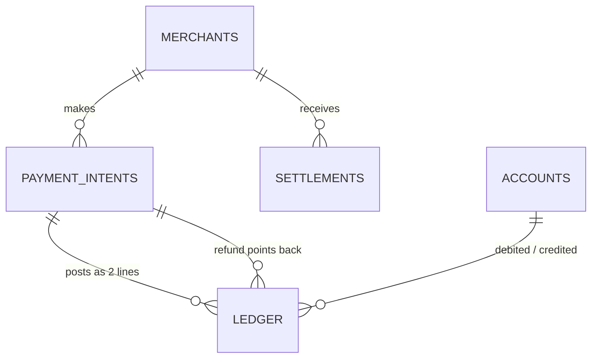
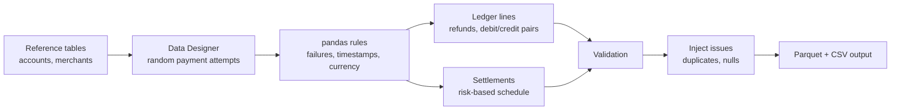

# PayFlow Ledger: Synthetic Payments Dataset

> One dataset in the [synthetic data generator](../README.md) repo. Run it with `python run.py payflow_ledger`.

A Python generator that builds a realistic, internally consistent **payments platform dataset with a double-entry ledger**. It uses **NVIDIA NeMo Data Designer** for the random columns and **pandas/numpy** for the business rules, and it is designed as the source data for an analytics engineering project (dbt, BigQuery, Power BI).

No real customer or financial data is used. Everything is synthetic.

## Why this project exists

Public payments data is hard to find, and real data cannot be shared. This generator produces a dataset that behaves like a real payment platform, so you can practice and demonstrate:

- Data modeling (staging, dimensions, facts, marts)
- Data quality testing (duplicates, nulls, balance checks)
- Financial reconciliation (ledger versus settlements)
- Operational analytics (gateway success rates, failure reasons, merchant risk)

## What it generates

| Table | Rows (approx.) | Description |
|---|---|---|
| `accounts` | 10 | Chart of accounts with account type and normal balance |
| `merchants` | 12 | Merchants across 12 countries with risk tier, currency and onboarding date |
| `payment_intents` | 27,000 | Every payment attempt, including failed ones with a failure reason |
| `ledger` | 52,000 | Double-entry lines (one DEBIT and one CREDIT per posted payment or refund) |
| `settlements` | 2,000 | Merchant payouts on a schedule based on risk tier |

Each table is saved as **Parquet and CSV**.

### Data model



## How realistic is it?

- **Double-entry bookkeeping:** every payment or refund creates exactly one DEBIT and one CREDIT line of equal amount, so each entry nets to zero.
- **Failures that make sense:** failure rates differ by payment gateway (about 2% to 12%) and rise for high-risk merchants. Failure reasons depend on the gateway and risk (for example, the flakiest gateway has far more timeouts, high-risk merchants have more fraud blocks).
- **Time patterns:** about 12 months of history, quieter weekends, busier month ends, and posting delays that depend on payment status.
- **Refunds:** about 3% of succeeded payments get a full or partial refund 1 to 30 days later, linked to the original payment.
- **Risk-based settlements:** low-risk merchants settle daily, medium-risk weekly, and high-risk monthly with 10% held back as a reserve. A small share of payouts fail, and the open period is pending.
- **Multi-currency:** each merchant has its own currency (USD, GBP, CAD, AUD, EUR, JPY, SGD, SEK, BRL, MXN).
- **Deliberate data quality issues:** the saved ledger contains about 0.5% exact duplicate rows and about 0.3% null gateway values, so downstream data tests have real problems to catch. This can be switched off.

## How it works



1. Fixed reference tables are defined in code, so ids, names, countries and currencies always match.
2. NeMo Data Designer generates the independent random columns of each payment attempt (merchant, amount, status, gateway).
3. pandas and numpy apply everything that depends on other columns: failures by gateway and risk, timestamps, currency from the merchant, `amount_cents` derived from `amount`, refunds, debit/credit pairs and settlements.
4. A validation step checks the clean data and stops the script if anything is wrong.
5. Optional issues are injected into the ledger, then every table is saved.

## Where things live

```
generators/payflow_ledger.py          # this dataset's generator (reference data, rules, validation)
helpers.py, File_Manager.py           # shared code
Synthetic_Data/payflow_ledger/
├── <timestamp>/                      # one folder per run
└── latest/                           # most recent run, stable file names
logs/payflow_ledger.log
```

## Run it

Set up the environment as described in the [main README](../README.md), then:

```bash
python run.py payflow_ledger
```

Output appears in `Synthetic_Data/payflow_ledger/<timestamp>/` and `Synthetic_Data/payflow_ledger/latest/`.

## Configuration

All settings are constants at the top of `generators/payflow_ledger.py`.

| Setting | Default | Meaning |
|---|---|---|
| `SEED` | 42 | Seed for the pandas/numpy randomness |
| `TARGET_PAYMENT_INTENTS` | 27,000 | Number of payment attempts, failed included |
| `HISTORY_DAYS` | 365 | Length of the history window |
| `REFUND_RATE` | 0.03 | Share of succeeded payments that are refunded |
| `FEE_RATE` | 0.029 | Platform fee in each settlement |
| `GATEWAY_FAILURE_RATE` | 2% to 12% | Failure chance per gateway |
| `RISK_FAILURE_MULTIPLIER` | 0.8 / 1.0 / 1.6 | Failure multiplier by merchant risk tier |
| `SETTLEMENT_SCHEDULE` | daily / weekly / monthly | Settlement schedule by risk tier |
| `RESERVE_RATE` | 0% / 0% / 10% | Share of net held back per schedule |
| `INJECT_ISSUES` | True | Add duplicates and null gateways to the ledger |

To change the reference data (accounts, merchants, descriptions, gateways, posting rules), edit the lists at the top of the file.

## Validation

Before anything is saved, the script checks that:

- primary keys are unique in every table
- every ledger row points to an existing merchant and account
- there are no unexpected nulls
- `amount_cents` always equals `amount` times 100
- `posted_at` is never earlier than `created_at`, and nothing happens before a merchant's onboarding date
- every ledger entry balances to zero
- every ledger payment exists in `payment_intents`, and no failed payment is in the ledger
- every refund points to a real payment
- `failure_reason` appears only on failed attempts
- total settlement gross equals succeeded payments in the ledger

If any check fails, the script stops with a list of problems.

## Planned next steps

- Load the tables into BigQuery and build a dbt project:
  - staging models (including deduplication of the ledger)
  - dimensions and facts
  - marts: daily merchant revenue, gateway success rate, trial balance, settlement reconciliation, merchant risk
  - tests, including a custom test that every payment balances to zero
  - a snapshot of merchant risk tier changes
- Build a Power BI dashboard on top of the marts.
- Release held reserves after a delay, and post reserve movements to the ledger.
- Make amounts and time of day more realistic (many small payments, activity peaking in business hours).

## Known limitations

- Reference data is small and fixed (10 accounts, 12 merchants).
- Amounts are uniformly distributed between 10 and 5,000 and time of day is uniform, which is less realistic than real traffic.
- The Data Designer columns (merchant, amount, status, gateway) are not tied to `SEED`, so those values can differ between runs. Everything generated in pandas/numpy is seeded.
- JPY has no minor unit, so `amount_cents` is not strictly correct for it.
- The posting rules (which accounts are debited and credited) are simplified placeholders.
- Data Designer API details such as where `artifact_path` is passed may need small adjustments depending on the installed version.

## License

Add your preferred license here (for example, MIT).
